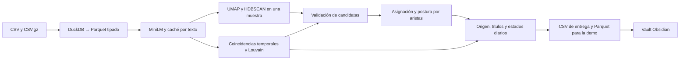
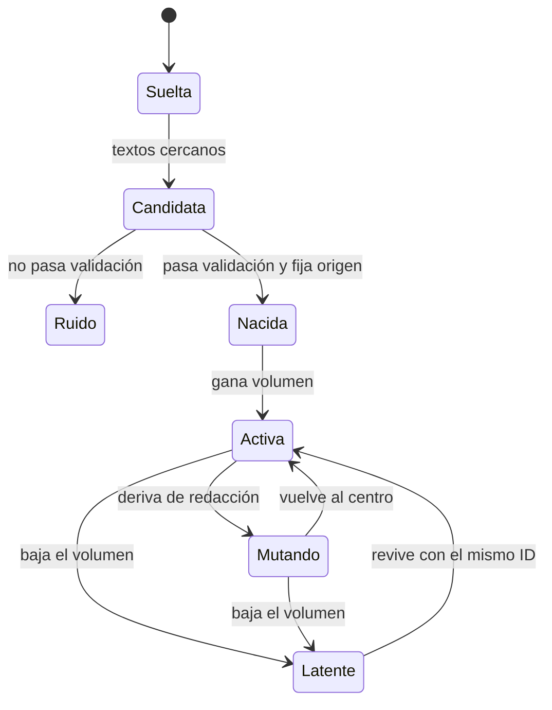
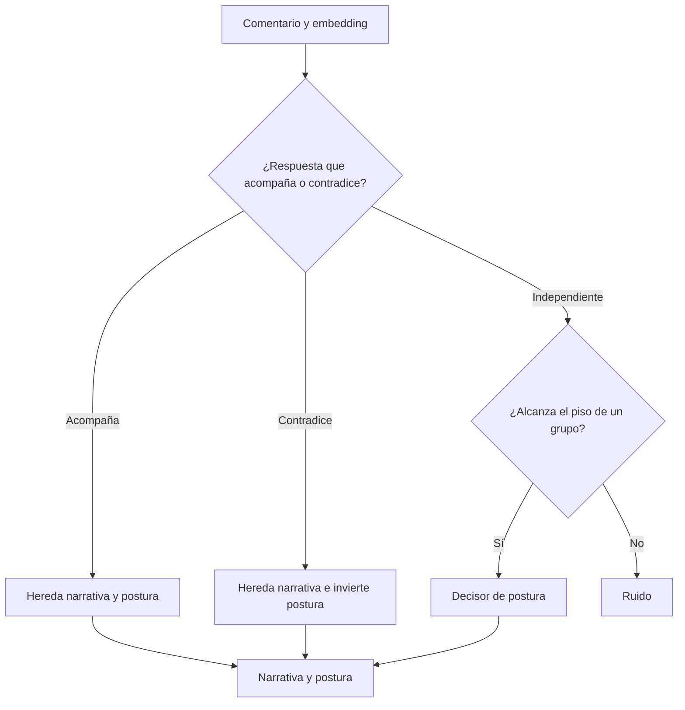

# QualyData · Argentina Space 2026

El pipeline descubre afirmaciones recurrentes, estima su origen y detecta cuentas que coinciden repetidamente. Los datos del desafío son sintéticos. [Enunciado oficial fijado al commit usado en este setup](https://github.com/qualydata-org/desafio-qualydata/blob/8cbe921b67c1ef5943183de67ecb181e370322f5/README.md).

## Reproducir en una máquina nueva

Usa Python 3.12 en macOS o Linux. Desde la raíz del repo, instala las dependencias fijadas.

```bash
python3.12 -m venv .venv
source .venv/bin/activate
python -m pip install -r requirements.txt
git clone https://github.com/qualydata-org/desafio-qualydata.git .cache/qualydata-upstream
git -C .cache/qualydata-upstream checkout 8cbe921b67c1ef5943183de67ecb181e370322f5
mkdir -p datos
cp -R .cache/qualydata-upstream/datos/practica datos/practica
python pipeline.py --datos datos/practica --entrega salida/practica
python eval.py
python export_vault.py
```

La primera corrida descarga MiniLM desde Hugging Face sin clave y calcula los embeddings en CPU. Con el modelo en caché puedes correr con `HF_HUB_OFFLINE=1`. `eval.py` ejecuta de nuevo el pipeline para el set completo y para cada mitad cronológica. [Sentence Transformers](https://sbert.net/docs/package_reference/sentence_transformer/model.html).

Para reproducir la línea base oficial con un hilo y puntuarla, ejecuta estos comandos.

```bash
OMP_NUM_THREADS=1 OPENBLAS_NUM_THREADS=1 python ejemplos/linea_base.py --datos datos/practica --entrega salida/base
python evaluacion/puntuar.py --verdad datos/practica/verdad --entrega salida/base --json salida/base/puntaje.json
```

## Entrega final

Descarga los cuatro archivos de la [publicación del set final](https://github.com/qualydata-org/desafio-qualydata/releases/tag/set-final) en `datos/final/` y ejecuta el comando que vuelve a correr el jurado.

```bash
python pipeline.py --datos datos/final --entrega entrega
```

`entrega/` contiene `comentarios.csv`, `narrativas.csv`, `cuentas.csv` y `costo.json`. El pipeline escribe los Parquet auxiliares y `metricas.json` en `salida/final/` para este comando. El cierre oficial es el viernes 13 de noviembre a las 13 h de Salta. Antes del cierre, sube el código y `entrega/` al repo público y registra el enlace y el video de demo en Hacki.

## Arquitectura



El agrupamiento estima la cantidad de candidatas con HDBSCAN. La asignación compara los embeddings con centroides en lotes y deja ruido cuando la similitud queda bajo el piso del grupo. Las candidatas necesitan tamaño, cuentas distintas descontando coordinación, y persistencia temporal o entre publicaciones. Coordinación usa guiones exactos y vecinos temporales por coseno. Cada publicación aporta como máximo una coincidencia a cada par de cuentas. Louvain agrupa el grafo de coincidencias repetidas.

### Ciclo de vida de una narrativa



`estados.parquet` registra volumen, postura, fracción coordinada y deriva diaria. Amplificada es un atributo independiente del estado. El origen toma la primera fecha válida del núcleo.

### Recorrido de un comentario



### Almacenamiento y escala

DuckDB importa y tipa los CSV. Parquet con Zstandard conserva IDs como texto, fechas con zona, y métricas como números. La huella del contenido de entrada identifica la caché de conversión. La caché de embeddings guarda un vector por hash del texto normalizado y revisión del modelo. Los IDs se vinculan con esos vectores al leer cada lote. Eso permite que las particiones y réplicas reutilicen embeddings sin mezclar etiquetas. `analizar_practica.py` consulta las tablas con DuckDB.

La corrida de entrega trabaja en memoria. Para millones de comentarios por día, se pueden particionar los Parquet por fecha, resolver embeddings faltantes por lote y mantener centroides, aristas e IDs entre ventanas. Una versión incremental necesita medir por separado el cambio de calidad que introduce el contexto parcial.

### Modo local y modo con API

El modo local usa MiniLM y reglas de postura en español. Para experimentar con NLI local, fija `nli_model` y `nli_revision` en `decisores.py`. Esa ruta es opcional y no se usó en las mediciones de referencia. Las predicciones y los Parquet usan semillas, orden e identificadores estables.

En modo local, los ocho archivos de salida son idénticos byte a byte entre corridas con la misma entrada, software y caché. `costo.json` y `metricas.json` conservan los tiempos reales de la primera corrida como referencia, identificada por `medicion.huella`. `.cache/reportes/` guarda únicamente esas duraciones; las predicciones, la calidad y los costos se calculan de nuevo. La huella incluye los cuatro archivos de entrada, el código de pipeline y decisores, parámetros, versiones y plataforma. Cambiar cualquiera de ellos crea otra referencia. Borrar esa caché vuelve a medirla.

Cada ejecución imprime una línea JSON `telemetria: ...` con sus tiempos reales por etapa. `eval.py` usa esos tiempos actuales para la métrica combinada y `experiments.tsv`, aunque los archivos conserven la referencia. En modo Jev, los JSON reportan el gasto y la latencia de las llamadas nuevas; la reproducibilidad byte a byte se verifica en modo local. Para comprobar las regresiones del reporte y la penalización temporal, ejecuta `python -m unittest discover -s tests -v`.

Para probar Jev, exporta `TYPESAFE_API_KEY` en tu shell y agrega `--decisor jev`. El pipeline enruta una fracción acotada de raíces con margen bajo y guarda las decisiones exitosas en SQLite. Las respuestas servidas desde caché cuentan para la cobertura de IA. Los tokens y dólares corresponden a llamadas nuevas. Sin clave o ante fallos de solicitud, el decisor local entrega la respuesta. [TypeSafe Choice](https://docs.typesafe.ai/primitives/choice.md).

## Resultados y costo

Consulta [RESULTS.md](RESULTS.md) para los tiempos y puntajes medidos. Para repetir la curva de escala, ejecuta:

```bash
python escala.py --factores 1 5 20
```

`--incluir-50` agrega una réplica ×50. Los resultados se guardan en `salida/escala/`. Las réplicas conservan la distribución de textos y reutilizan sus embeddings, así que miden el procesamiento de más filas con caché caliente.

## Demo en Obsidian y Quartz

Corre `python export_vault.py` y abre `vault/` como carpeta existente en Obsidian. Abre `index.md` para recorrer narrativas, operaciones y fuentes. Dataview es opcional. Las tablas estáticas y los enlaces funcionan sin el plugin. Para la corrida final usa `python export_vault.py --datos datos/final --entrega entrega`. [Abrir una carpeta como vault](https://obsidian.md/help/vault).

Para la demo estática, crea un proyecto Quartz, importa `vault/` como contenido con `npx quartz create` y ejecuta `npx quartz build --serve`. Quartz genera el sitio en `public/`. Publica ese directorio en el proveedor estático que elija el equipo. [Instalación y despliegue de Quartz](https://quartz.jzhao.xyz/).

## Código y dependencias previas

`ejemplos/linea_base.py` y `evaluacion/puntuar.py` son copias del código oficial de QualyData en el commit citado. El pipeline, la evaluación por ventanas y el exportador se prepararon para el hackathon. DuckDB, PyArrow, pandas, NumPy, scikit-learn, UMAP, HDBSCAN, NetworkX, PyTorch, Transformers, Sentence Transformers, MiniLM y E5 son dependencias públicas preexistentes. Jev es un servicio externo opcional.

### Caché y evaluación de la configuración actual

Los encoders locales están fijados por modelo y revisión en `pipeline.py`. La coordinación usa evidencia complementaria de MiniLM y E5, independientemente de la representación de narrativas. Preparar modelos y embeddings antes de comparar tiempos del arnés; una entrada con textos nuevos necesita su primera codificación. Los puntajes, tiempos y límites de la búsqueda están en `RESULTS.md`, `NOTES.md` y `experiments.tsv`.
