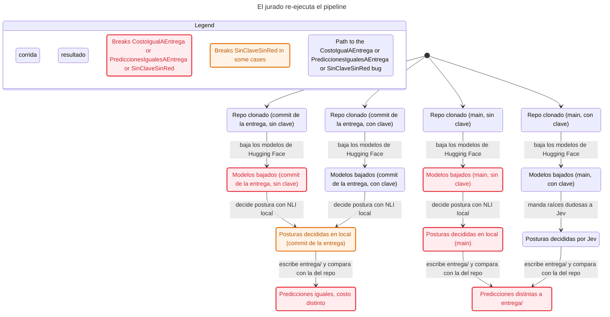
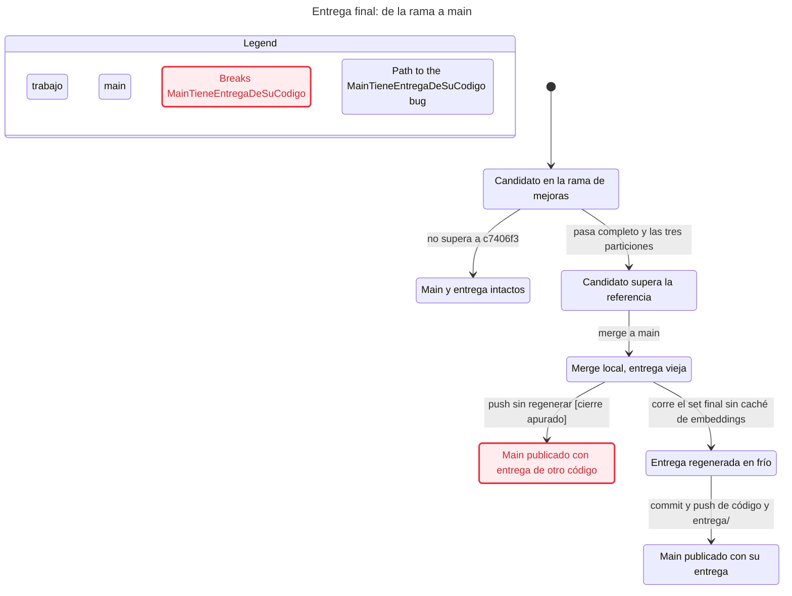
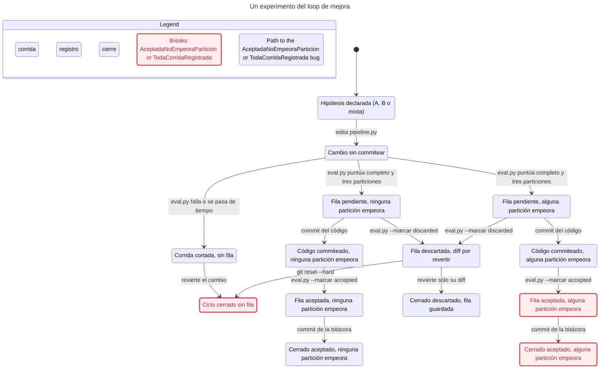
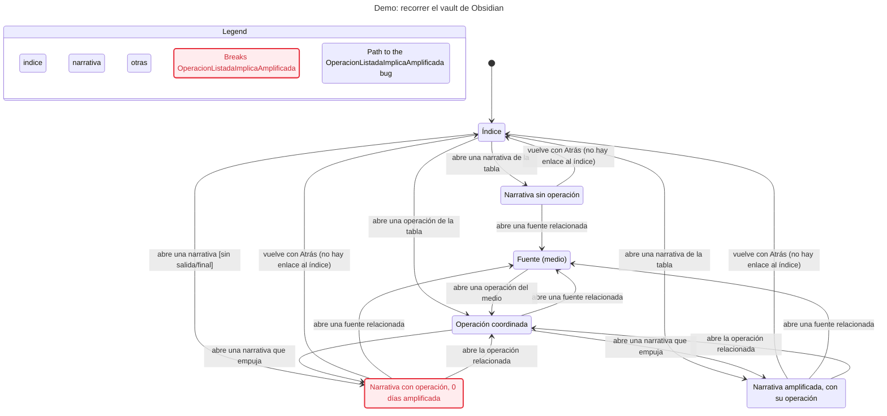

# Statecharts de los flujos principales

Cuatro flujos del proyecto modelados en TLA+, verificados con TLC y dibujados como statecharts. Cada carpeta tiene el modelo (`.tla`, `.cfg`), las etiquetas en español (`view.ts`), el chart (`chart.mmd`) y el reporte de TLC (`report.md`). Un estado con borde rojo rompe una regla. Uno con borde naranja la rompe en algunos casos. Las violaciones que vienen del código real están en [../violaciones/statecharts.md](../violaciones/statecharts.md).

Los modelos describen el código de `60c4a68` (`main`). El comando de cada sección vuelve a generar los archivos. `<skill statechart>` es la carpeta de la skill `statechart` de pstack. TLC tarda unos 2 s por modelo.

## 1. El jurado re-ejecuta el pipeline

El jurado clona el repo, baja el set final y corre `python pipeline.py --datos datos/final --entrega entrega`. El modelo cruza dos decisiones del jurado: qué commit usa (`main` o el `c7406f3` que generó `entrega/`) y si tiene `TYPESAFE_API_KEY`. Termina cuando compara su `entrega/` con la del repo.



Reglas que se cumplen:

- **SinClaveNoLlamaJev.** Sin clave nunca se llama a la API de Jev. `DecisionEngine` baja a modo local si falta la clave (`decisores.py`, `DecisionEngine.__init__`).

Reglas que se rompen:

- **PrediccionesIgualesAEntrega.** Con `main` las predicciones no salen iguales a `entrega/`. Camino: repo clonado (main, sin clave) → baja modelos → decide en local → predicciones distintas. `entrega/` la generó `c7406f3`, y `main` trae NLI local y cambios de postura que FINAL_RUN.md declara sin aplicar. Con clave en `main`, el default `--decisor jev` también cambia las posturas.
- **CostoIgualAEntrega.** `costo.json` nunca sale igual, ni con `c7406f3`. La máquina del jurado no tiene `.cache/reportes/` (no está en git), así que guarda sus propios segundos y su `hardware`. Camino: el mismo de arriba.
- **SinClaveSinRed.** Sin clave igual hay red. En una máquina nueva `pipeline.embeddings` y `LocalNLI` bajan los pesos fijados desde Hugging Face. No es una API con clave ni tiene costo, pero sí es tráfico externo. Camino: repo clonado (main, sin clave) → baja los modelos de Hugging Face.

Qué deja afuera: fallos o timeouts de Jev (caen al decisor local), el contenido de las predicciones, el determinismo entre sistemas operativos (se asume), `HF_HUB_OFFLINE=1` con pesos ya bajados, y la descarga del set final y la verificación de SHA-256.

```sh
<skill statechart>/scripts/statechart docs/statecharts/jurado-reejecuta/JuradoReejecuta.tla --config docs/statecharts/jurado-reejecuta/JuradoReejecuta.cfg --view docs/statecharts/jurado-reejecuta/view.ts --out /tmp/jurado-reejecuta-nuevo
```

## 2. Entrega final: de la rama a main

El protocolo de `program.md` exige que un candidato pase la aceptación en la rama de mejoras, entre a `main`, se corra en frío sobre el set final y se suba junto con su `entrega/`. El modelo agrega el cierre real de FINAL_RUN.md: el push a `main` sin regeneración fría. La regla mira `origin/main`, lo que ve el jurado.



Reglas que se rompen:

- **MainTieneEntregaDeSuCodigo.** `origin/main` publica código cuyo `entrega/` salió de otro commit. Camino: candidato en la rama → pasa completo y las tres particiones → merge a main → push sin regenerar. Es el estado actual: `60c4a68` tiene el código de la experiencia 145 y `entrega/` de `8a1f5be` (código `c7406f3`). El camino planeado (merge → corrida en frío → commit y push) sí cumple la regla.

Qué deja afuera: la validación de formato de `entrega/` (siempre pasa en el modelo), una corrida en frío que falla o no entra en el plazo, el chequeo de que la caché de embeddings esté vacía (nada en el código lo exige), y el estado intermedio del `main` local.

```sh
<skill statechart>/scripts/statechart docs/statecharts/entrega-final/EntregaFinal.tla --config docs/statecharts/entrega-final/EntregaFinal.cfg --view docs/statecharts/entrega-final/view.ts --out /tmp/entrega-final-nuevo
```

## 3. Un experimento del loop de mejora

Cada hipótesis edita `pipeline.py`, corre `eval.py` sobre el completo y las tres particiones, y se marca aceptada o descartada en `experiments.tsv`. El modelo sigue un solo experimento hasta que se cierra. `empeora` dice si alguna partición perdió puntos de la tarea.



Reglas que se rompen:

- **TodaCorridaRegistrada.** Una corrida que falla o se pasa de tiempo no deja fila. Camino: hipótesis → edita → eval.py falla o se pasa de tiempo → revierte. `eval.invoke_pipeline` lanza `RuntimeError` antes de `append_experiment`. El otro camino que la rompe es `git reset --hard` después de `--marcar discarded`: `experiments.tsv` está en git y la fila todavía no se commiteó.
- **AceptadaNoEmpeoraParticion.** `eval.py --marcar accepted` acepta aunque una partición haya empeorado. Camino: hipótesis → edita → puntúa (alguna partición empeora) → commit del código → `--marcar accepted`. `mark_experiment` sólo cambia el estado. La comparación por tarea y partición contra el comparador de `program.md` la hace a mano quien corre el loop. Además `dia_1_10` no tiene columna en el TSV, sólo aparece dentro de `componentes`.

Qué deja afuera: el puntaje concreto, la elección de tarea A/B/mixta, el piso de precisión ≥0,9, el desempate por tiempo, varias filas pendientes a la vez y el loop entre experimentos (se modela uno).

```sh
<skill statechart>/scripts/statechart docs/statecharts/experimento-loop/ExperimentoLoop.tla --config docs/statecharts/experimento-loop/ExperimentoLoop.cfg --view docs/statecharts/experimento-loop/view.ts --out /tmp/experimento-loop-nuevo
```

## 4. Demo: recorrer el vault de Obsidian

`export_vault.py` escribe `index.md`, una nota por narrativa, por operación y por fuente. Los enlaces reales son índice → narrativa y operación, narrativa ↔ operación, y las dos hacia y desde fuentes. Ninguna nota enlaza de vuelta al índice. El modelo distingue si existen los Parquet auxiliares de `salida/final/`, que no están en git.



Reglas que se cumplen:

- **NarrativaAmplificadaEnlazaOperacion.** Si una narrativa muestra días amplificada, su nota enlaza a la operación. El salto narrativa → operación existe (`operation_links_by_narrative`) y la operación vuelve con «Narrativas que empuja».

Reglas que se rompen:

- **OperacionListadaImplicaAmplificada.** Sin `salida/final/` la nota lista una operación y dice `dias_amplificada: 0`. Camino: índice → abre una narrativa [sin salida/final]. Reproducido con `entrega/` y el set final: `narrativa-n002.md` lista operaciones y muestra `volumen_total: 5`, `estado_actual: "desconocido"` y `dias_amplificada: 0`. Con los Parquet presentes la regla se cumple, porque `estados_por_dia` marca amplificado al menos el día de mayor cuota coordinada.

Qué deja afuera: Dataview, Quartz, el contenido de cada nota, cuántas narrativas u operaciones hay y el botón Atrás de Obsidian como historial (se modela como volver al índice). Oculta los saltos fuente → narrativa y la vuelta al índice desde operación y fuente, que repiten flechas ya dibujadas.

```sh
<skill statechart>/scripts/statechart docs/statecharts/demo-vault/DemoVault.tla --config docs/statecharts/demo-vault/DemoVault.cfg --view docs/statecharts/demo-vault/view.ts --out /tmp/demo-vault-nuevo
```
